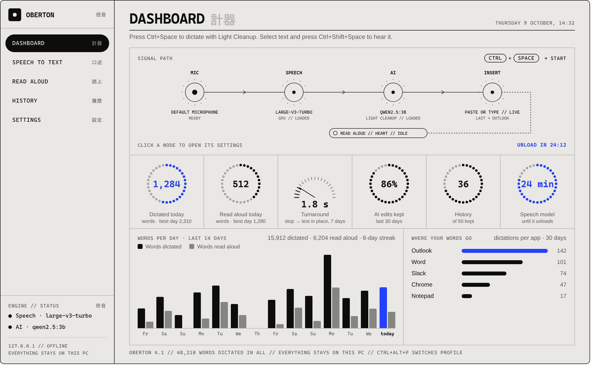
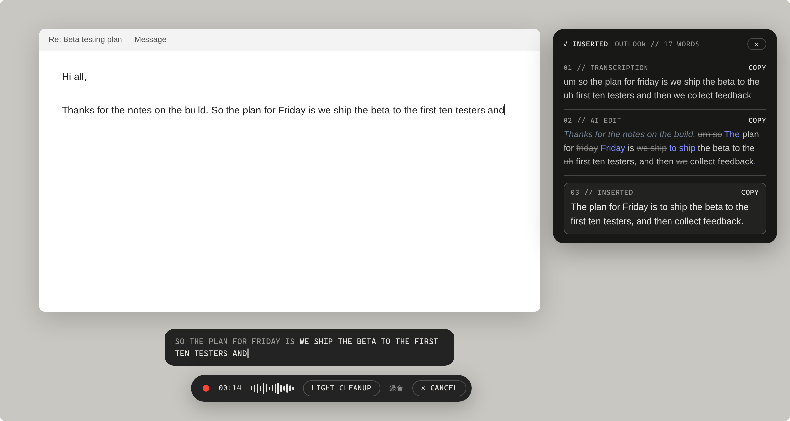
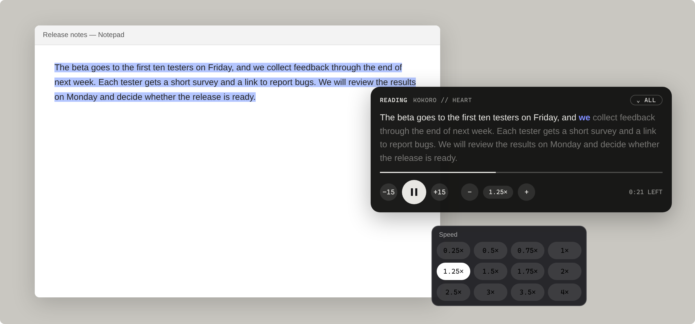

<p align="center">
  <picture>
    <source media="(prefers-color-scheme: dark)" srcset="docs/images/dashboard-dark.png">
    
  </picture>
</p>

<h1 align="center"><code>OBERTON</code> &nbsp;倍音</h1>

<p align="center">
  <b>LOCAL DICTATION // READ ALOUD // WINDOWS</b><br>
  <sub>The name is German for <i>overtone</i>: the AI adds a layer of polish on top of your own voice. (Formerly <i>Local Dictation</i>.)</sub>
</p>

<p align="center">
  <a href="https://github.com/silent-diffusion/dictation/releases/latest"><b>DOWNLOAD THE LATEST RELEASE →</b></a>
</p>

| `01 // DICTATE` | `02 // EXTENDED NOTES` | `03 // READ ALOUD` | `04 // STAYS ON YOUR PC` |
|---|---|---|---|
| Press **`Ctrl+Space`**, speak, press it again: cleaned-up text appears at your cursor, in any app. | Leave it on through a lecture or a meeting (your mic, the computer's audio, or both): transcript, AI-formatted text and a running summary, with the recording. | Select text, press **`Ctrl+Shift+Space`**: a natural local voice reads it, from 0.25× to 4×. | *Keep everything offline* is on by default. No accounts, analytics or telemetry. |

```
MIC ──→ SPEECH ──→ AI ──→ INSERT
        Whisper    qwen2.5:3b    at the cursor
                   (profiles)      ┆
                                   └┄┄ READ ALOUD  Kokoro · Piper · Windows voices
```

* **Speech recognition:** Whisper (via faster-whisper), GPU-accelerated on NVIDIA cards, CPU everywhere else.
* **Cleanup:** a small local language model (default `qwen2.5:3b`) served by Ollama, driven by editable **profiles**.
* **Optional cloud:** cloud models (Anthropic's Claude, OpenAI and compatible services) can be chosen per profile, with
  your own API key.

### `DICTATING`



<sub>While you talk, the overlay shows the live transcript under a red recording dot. Click it afterwards for the
three boxes: what you said, what the AI changed (with the text around your cursor in grey-blue), and what went in.</sub>

### `READING ALOUD`



<sub>The player follows along word by word. Click a word to read from there; click the speed for the menu.</sub>

<sub><i>These pictures are drawn from the app's own colours, type and layout (<code>docs/images/screens.html</code>)
with example figures; they are illustrations, not captures of a real session.</i></sub>

---

## Install

1. Download **`Oberton-Setup-x.y.z.exe`** from the [latest release](https://github.com/silent-diffusion/dictation/releases/latest).
2. Run it. Windows may show *"Windows protected your PC"* because the installer isn't code-signed yet - click **More info → Run anyway**.
   No administrator rights are needed; it installs just for your user account.
3. On first launch the app downloads its speech engine, AI runtime and models (one time, needs internet):

| | NVIDIA GPU | No NVIDIA GPU |
|---|---|---|
| Download | ~5.5 GB | ~3 GB |
| Speech model | `large-v3-turbo` | `small.en` |
| Typical wait after you stop talking (20 s of speech) | **~1-2.5 s** | **~8 s** (on a recent 8-core laptop CPU) |

Then click into any text field, press **Ctrl+Space**, talk, and press **Ctrl+Space** again.
The app lives in the system tray; closing the window keeps it running.

**Requirements:** Windows 10 (1809+) or 11, 64-bit, ~8 GB free disk. An NVIDIA GPU with 6 GB+ is recommended but optional.

### Updating

*Settings → Updates → Check for updates* (or the tray menu). If there's a newer release it downloads the installer
and updates in place; your settings, profiles and downloaded models are kept. You can also turn on *Check for updates when Oberton starts*.

### Uninstalling

*Windows Settings → Apps → Oberton → Uninstall*. You'll be asked whether to also delete the downloaded models and settings.

### Where things are

| Path | What |
|---|---|
| `%LOCALAPPDATA%\LocalDictation\app` | the program (replaced on update) |
| `%LOCALAPPDATA%\LocalDictation\runtime` | private Python 3.12 + speech engine, portable Ollama |
| `%LOCALAPPDATA%\LocalDictation\models` | Whisper and language models |
| `%LOCALAPPDATA%\LocalDictation\data` | `settings.json`, `profiles.json`, `logs\` |

The folder keeps its pre-rename name so updates from Local Dictation 1.x keep your models and settings.

---

## Using it

The sidebar has seven sections: **Dashboard** (one screen, no scrolling: the signal path, drawn as a diagram of what's active and loaded
(microphone → speech model → AI model and profile → insert, with read aloud branching off; each node's status, the hotkey and
the unload countdown), meters for words dictated and words read aloud today, turnaround,
AI edits kept, history and the speech model's unload countdown; the signal path grows with the window. Every step and meter opens its page when
clicked (History, Analytics, the profiles, Microphone, Model unloading); the big number on the speech-model meter unloads that model
right away, and the big number on the History meter copies the last dictation's AI edit (or its text, without one) and says so. The figures come from daily counts in
`data\usage.json` (dictations, words, seconds spoken, turnaround, AI edits kept, readings and dictations per app name; never
any text, audio or window titles), so they survive History being trimmed, cleared or off), **Extended Notes**, **Speech to text** (profiles), **Read aloud**, **History**, **Analytics** and **Settings**. Beside the
signal path, the dashboard has an **Extended Notes** cell: a title and a text box you can always type in (the live
transcript while a session records; between sessions a notepad, which the next session begins with); before a
session its title's spot is an *Extended notes session* button (its red ring fills once it records; click the dot to stop),
and *Full screen* opens the live session (or Extended Notes when nothing records). The menu button
in the top-left corner (✕ while the sidebar is open, ☰ while it's hidden; or **Ctrl+B**) slides the sidebar away to give
the page the whole window. **Back** (after the logo, or next to ☰ while the sidebar is hidden; also `Alt+←` or the mouse's
back button) returns to the page you were on before, Settings sections included; it shows on every page but the dashboard.
With the sidebar hidden, ☰ and Back sit in a fixed bar across the top of the window, so pages scroll underneath it
instead of behind floating buttons, and pages with a side menu of their own (Settings, Speech to text) go right up to the
window's edge.

* **Hotkey** (default `Ctrl+Space`, change under *Hotkeys*): start/stop. `Ctrl+Alt+P` cycles profiles; `Ctrl+Alt+M` drops a
  marker while an Extended Notes session records.
* **Overlay**: a pill, always on top, never steals focus. Small while you talk (timer, level meter, active profile, and
  **✕ Cancel**, which stays until the text is in: while starting, recording, transcribing and tidying up);
  while you speak, the words recognized so far run above it; it grows to show your transcript while the AI tidies it, then shows a small dimmed "Inserted" receipt. Hover it to see it clearly;
  click it to see the three boxes used everywhere in the app (the receipt, profile pages, History): **Transcription**,
  **AI Edit** (removed words struck through, new ones highlighted, with the text around the cursor either side in grey-blue italics) and **Inserted** (the clean text that went in).
  The text in those boxes can be selected with the mouse, and each box has a **Copy** button (it copies what you selected,
  or the whole box; for AI Edit, the AI's own text without the struck-through words).
  If the safety net rejects the AI's edit, the receipt says so. Position (nine spots) and opacity are under *Settings › Layout*.
  With *preview before inserting*, the preview shows the same three boxes, with **Inserted** (what *Insert* puts in) brought
  forward, larger and more solid, and the other two dimmed.
  Drag the pill (or the Read aloud player) anywhere; it stays there until Oberton restarts or you pick a position. The Read
  aloud player has its own card under *Settings › Layout* (opacity, and a position of its own or the pill's).
* **Fits the surrounding text**: a sentence or two around the cursor is read (locally, via Windows accessibility) so a word or phrase
  dictated mid-sentence isn't capitalized or given a period, and missing spaces are added. Works in apps that expose their text
  (Word, browsers, most text boxes); turn it off under *Settings › General*. That text is never stored, logged or sent to the AI.
* **Type as you speak**: finished sentences appear in the app about every 5 seconds while you talk (cleaned up piece by piece).
  Each piece is transcribed once; when you press the hotkey again, only the speech after the last piece is transcribed, and
  the AI cleans up all the pieces together in one final pass that replaces them (selected and pasted over where the app shows its text to Windows; in apps that don't, such as terminals and Claude Code, erased with Backspace and pasted again). The
  replacement only happens after Oberton confirms, through Windows accessibility, that the text before the cursor is exactly
  what it typed; otherwise that text is kept and only the rest is added. `Esc` takes the typed text back the same way.
  Turn it off under *Settings › General*; profiles that preview before inserting don't use it.
  With a profile that doesn't use AI (*Raw*), the words go into the app as they are heard, about every second, the same
  words the overlay shows, and are corrected in place (with Backspace) when the recognizer revises its guess. Each new bit
  is pasted; the profile can type it key by key instead (*Type the words in, instead of pasting them*).
  While you dictate, Oberton holds the clipboard and leaves at least 0.7 s between pastes; your own clipboard comes
  back once the dictation is done, so a paste the app reads late can never insert what you had copied before.
* **Pastes where you started**: Oberton remembers where the cursor was when you pressed the hotkey. If you click
  somewhere else while it works, in that app or another, the text still goes back to that spot (the window is brought
  back and, where the app shows its caret to Windows, the caret put back where it was). If nothing to type into had the
  cursor (the desktop, the taskbar, a button), the pill says **No place to paste**: click into any text field and the
  text goes in there, or press **Copy to clipboard** (or the hotkey). After two minutes it is copied for you.
* **No phantom text**: very short or silent recordings insert nothing, so Whisper's habit of hearing "Thank you." in silence never reaches your document.
* **Long dictation** is cleaned up a few sentences at a time (small models stay faithful on short passages), and the safety net applies to each piece separately.
* **Read aloud** (`Ctrl+Shift+Space`): reads the selected text in any app with a natural voice that runs on
  your PC. With nothing selected, it offers to read your clipboard. The player has play/pause, back and forward 15 seconds,
  slower/faster (click the speed itself for a menu from 0.25× to 4×), the time left, and the sentence being read with the current word highlighted. Pick the voice and the base
  speed under *Read aloud*; changing the speed in the player is remembered for the next reading. Every voice paces itself
  naturally from 0.5× to 2×; beyond that the audio is time-stretched without changing its pitch. Three text-to-speech models:
  **Kokoro v1.0** (the most natural; 8 voices, about 370 MB, downloaded the first time you use it), **Piper** (light and fast,
  even on slower PCs; 6 English voices, each a separate 60 to 120 MB download) and **Windows voices** (the ones installed
  with Windows; nothing to download, more robotic). Kokoro and Piper both run in Oberton's local voice server on this PC.
  A profile can pick its own model and voice, for reading its dictations back and for the hotkey while it is active.
  Text is read as plain text: Markdown (headings, lists, **bold**, links, tables, code fences) and stray symbols are dropped.
  The ⌄ button shows the whole text, scrolling along as it is read, with its Markdown shown formatted (headings, bullet
  and numbered lists, quotes, code, bold, italic and links) while the voice reads it as plain text. Click any word in that
  view to have the voice jump there, forwards or backwards. The player's opacity is a setting under *Read aloud*.
* **Settings**: grouped into Dictation, Models & AI, Look & feel and App; each group folds away (remembered).
  **Appearance** follows the Windows light/dark setting, or pick Light or Dark, plus an accent color (Cobalt, Teal,
  Signal green, Violet, Amber), each with a version for light and for dark paper. **Layout** places the dictation overlay and the Read aloud player
  (nine positions each) and sets their opacity.
  **About** explains what Oberton is, how it works and its design language, with the meaning of every Japanese
  word in the interface.
* **Design** (4.0): Oberton is drawn like a printed instrument panel: black ink on gray paper, 1px lines, capitalized
  monospaced labels and readouts, rings of dots and block bars for numbers; dark mode is the same sheet inverted. Color is
  a signal: the accent marks what is live or most important (today's count, a countdown, the word being read, words the AI
  added, errors), and red means the microphone is recording, nowhere else. The small Japanese words beside some labels
  (倍音 overtone, 計器 instrument, 口述 dictation, 読上 reading aloud, 履歴 history, 設定 settings, 概要 about, 録音 recording,
  処理中 processing, 挿入 insertion) are decoration only and hidden from screen readers.
* **Profiles** (*Speech to text*): *Light Cleanup*, *Grammar & Clarity*, *Natural Phrasing*, *Custom*, *Raw* (no AI: the recognizer's words,
  with the seams between live pieces fixed), plus your own. Edit the prompt, pick a model (only models downloaded to this PC are listed, plus cloud models once
  they are set up), pick its models in one *Models* card: a speech-to-text (Whisper) model, the AI model and a Read aloud model and voice (downloaded ones only; a profile with
  its own speech model loads it when you switch to it, and recording starts right away meanwhile), toggle
  *Use AI* (off hides the instructions, model and other AI settings; only *Raw* has it off), *preview before inserting* (shows the edits; hotkey or *Insert* inserts, `Esc` discards, *Use original* inserts raw),
  *read aloud after inserting* (Read aloud reads what went in), *preserve paragraphs*, *remove fillers*.
  *Rewrite the whole dictation* is for prompts that reshape what you say ("turn my thoughts into an email"): the AI gets the
  whole dictation in one go when you stop. With *Type as you speak*, your words are typed as spoken and the rewrite replaces them at the end.
  The **Try it** panel runs a profile on sample text and shows what it changed, so you can tune prompts without dictating; each of its three boxes has a COPY button.
  It follows the profile's switches: with *preview before inserting* the real preview appears, with *read aloud after
  inserting* the result is read to you.
* **History**: the last 50 dictations (adjustable under *Settings › History*, up to *All of them*), kept in Oberton's data folder so they survive
  updates. Each has its recording (play it, also at 2×), the Transcription, AI Edit and Inserted boxes (each can be copied),
  and the app and window it went into. List them newest first, or grouped by app (each app's group folds away).
* **Extended Notes** (5.0): for very long sessions, a lecture or a meeting. Pick what to listen to (**Mic**, **Computer
  audio**, which is what the speakers play, for the other people on a video call, or **Both**) and press *Extended notes
  session*. Four plain text tabs:
  **Transcript** (word for word, as it is heard; type anywhere to add your own notes), **Formatted** (tidied by the AI about
  every minute: punctuation, capitals, fillers out, paragraphs; the AI only ever adds new text after yours, so your edits
  stay), **Summary** (the main idea, three key points and at most three paragraphs; rewritten every 5 to 10 minutes from
  summaries of each part, which are folded together as the session grows; edit it freely, your version is kept) and **Edited** (read-only: every change in colour, the AI's apart from yours: removed by the
  AI struck through in grey, added by the AI in the accent, ¶ where the AI made a paragraph; removed by you, changed by you
  and notes typed by you in amber). The titles are click-to-rename. Once the session has stopped, the bar at the bottom
  plays the recording from where your cursor is in the text (1×, 1.5×, 2×, **Skip silences**) with its level brought up
  (mic recordings are quiet), and a right-click in any tab jumps to that moment in the recording; **Export** saves the
  transcript, the formatted text, the summary or everything as .txt, .md or Word (.docx), and the recording (as played) as .wav.
  While a session records, **⚑ Mark** in the header (or the marker hotkey, default `Ctrl+Alt+M`) drops a time marker
  on its own line in the transcript (the AI keeps it; a right-click on it jumps there; *Everything* exports list them).
  The AI model for Extended Notes is its own setting (Settings › Models, or *AI model* on the start card); by default the
  best on this PC, the largest installed model that fits in the GPU's memory.
  Extended Notes never count in the dictation statistics; their own daily counts are kept apart in `data\notes\usage.json`
  and shown as a **Usage** strip on the landing page (last 30 days and all time: sessions, time recorded, words heard and
  typed, AI requests, by source). **Pause**, **Full screen** and **Stop** are in the header; dictating into an
  app pauses the session for that moment. Everything is saved as it goes in `data\notes\` (a session.json and the
  audio.wav, about 115 MB an hour), so a crash keeps it; the landing page lists every session (search, open, delete).
  The speech engine is shared: notes open their own connection to the model already loaded, and no model unloads while a
  session records.
* **Analytics**: how dictation goes over the last 7, 30 or 90 days, or everything: words dictated, speaking pace, time saved
  against typing at 40 wpm, turnaround, AI edits kept and words read aloud; the **most corrected** words (what the recognizer
  heard and what the AI wrote instead, each with *Add to vocabulary*, which adds it to the speech vocabulary hint so the
  recognizer expects it next time); your **most used words** and **common phrases**; the fillers the AI removed; words per day
  (dictated and read aloud); when you dictate (weekday × hour); how much each profile changes your words; and the apps you
  dictate into. Words, phrases, corrections, fillers, hours and profiles come from the **word tally** in `data\words.json`:
  counts only, never sentences, updated after every dictation and seeded once from History. It is on by default; turn it off
  or reset it under *Settings › History*.
* **Models** (*Settings › Models*): every speech, AI and voice model as a list, showing whether it is downloaded, active and
  loaded, with **Download** and **Use this** buttons. Cloud models are marked CLOUD.
* **Model unloading** (*Settings*): unload models immediately after each use (a few seconds after a dictation or reading
  ends; they stay loaded while in use), after 1 minute to 4 hours unused (default 30 minutes), or never; or
  right now (*Unload everything*, or the speech model, AI model or Read aloud voice alone). Dictating
  never waits for a model: recording starts at once and the speech model catches up when it has loaded.
* **Cloud AI** (*Settings*): API keys (encrypted for your Windows account) and the *Keep everything offline* switch.
* If the AI fails, is unreachable, or returns something implausible (empty, summarised, rambling), your **raw words are inserted instead** - dictation is never lost.

### Other models

```powershell
powershell -ExecutionPolicy Bypass -File scripts\pull-model.ps1 qwen3:4b-instruct-2507-q4_K_M   # any Ollama tag
```
Or download models from **Settings › Models**, and pick the active one there (or per profile).

---

## Privacy

* Speech recognition and the language model run locally. Whisper runs with `HF_HUB_OFFLINE=1`; the Ollama endpoint must be loopback (other values are rejected) and Ollama's cloud features are disabled.
* A dictation's audio is held in memory while it runs. What is kept on disk, all under `%LOCALAPPDATA%\LocalDictation\data`
  and only for you: **History** (the last 50 dictations by default, with their recordings when *Save audio* is on, the app's
  name and window title; adjustable or off under *Settings › History*), **Extended Notes** sessions (transcripts and the
  recording, until you delete them; a louder playback copy of an opened session sits in `%TEMP%\oberton-notes` and is
  removed with the session or by the uninstaller), the daily **usage counts** (numbers only, never text) and the dashboard
  notepad. Logs record timings and sizes, never what you said.
* Read aloud reads your selection through UI Automation; in apps that don't offer it, it sends Ctrl+C and restores your
  clipboard afterwards, so for a moment the selection passes through the Windows clipboard.
* *Keep everything offline* (on by default) blocks the cloud providers and Ollama's own cloud models. With it off, a profile
  with a cloud model sends that profile's dictations to it, and Extended Notes send their text to the default AI model,
  whichever that is.
* Network access happens only for: the first-run download, and checking for updates (when you click it, or at startup if you enable that).
  The update check is a plain request for this repository's public release list.

---

## Architecture

```
┌──────────────────────── Dictation.App (WPF, UI only) ────────────────────────┐
│ MainWindow + pages · OverlayWindow (WS_EX_NOACTIVATE) · TrayIcon · HotkeyManager │
│ SetupWindow (first run) · AboutPage · UpdatesPage                                  │
└───────────────┬───────────────────────────────────────────────────────────────┘
                │ events / commands
┌───────────────▼──────────────── Dictation.Core (no UI) ───────────────────────┐
│ DictationController  (state machine: Idle→Recording→Transcribing→Processing→  │
│                       [Confirming]→Inserting)                                  │
│   IAudioCapture ─ MicCapture (NAudio) / FileAudioCapture (tests)               │
│   ISpeechRecognizer ─ SidecarSpeechRecognizer ──WebSocket 127.0.0.1──┐         │
│   ITextProcessor ─ OllamaTextProcessor ──HTTP 127.0.0.1──┐           │         │
│   TextInserter ─ ITextInsertionStrategy: ClipboardPaste | UnicodeTyping        │
│   RuntimeInstaller (first-run downloads) · UpdateService (GitHub Releases)     │
│   SettingsService · ProfileService · Log · ChildProcessJob                     │
└───────────────────────────────────────────────────────┼───────────┼───────────┘
                                                         │           │
                                         runtime\ollama (Ollama)   inference\asr_server.py
                                                                   (faster-whisper, CUDA or CPU)
```

* **Replaceable engines.** `ISpeechRecognizer` and `ITextProcessor` are the only things the controller knows. The Python server has a small
  `ENGINES` registry - add a class there (e.g. NVIDIA Parakeet) and select it in settings. Any Ollama model works for cleanup.
* **Small installer, big runtime.** The setup `.exe` (~50 MB) contains only the self-contained .NET app and the Python sidecar script.
  `RuntimeInstaller` downloads pinned versions of standalone CPython, the speech packages (`inference\requirements*.txt`), Ollama and the
  models on first launch. Every step is resumable, and the Python runtime is a plain relocatable folder (no virtualenv, no links).
* **Updates** come from GitHub Releases: `UpdateService` compares the latest release tag with the app version, downloads the installer and runs it
  silently; the installer replaces only `app\` and restarts the app.
* **Child processes die with the app** (Windows Job Object), even on a crash.
* **Insertion** remembers the foreground window at hotkey time, waits for the hotkey's modifier keys to be released, restores the target if needed,
  then pastes (Ctrl+V) - atomic, so it is reliable in Chromium/Electron apps, which drop or repeat characters when flooded with injected keystrokes.
  The clipboard is snapshotted and restored, and the temporary text is excluded from clipboard history/cloud sync. Paced Unicode typing is the
  fallback (or a per-app choice via `AppOverrides` in `settings.json`).

### Project layout

```
inference/                  Whisper sidecar (WebSocket, loopback only) + pinned requirements
src/Dictation.Core/         Audio, Speech, Text, Insertion, Session, Settings, Setup, Infrastructure
src/Dictation.App/          WPF app (Views/, Services/)
tests/Dictation.Tests/      xUnit tests
installer/                  Inno Setup script
scripts/                    developer scripts (setup, run, build, build-installer, pull-model)
.github/workflows/          CI (build + test) and Release (tag → installer → GitHub release)
```

---

## Development

```powershell
powershell -ExecutionPolicy Bypass -File scripts\setup.ps1   # portable .NET 10 SDK into tools\ (nothing system-wide)
powershell -ExecutionPolicy Bypass -File scripts\run.ps1     # build + run; first launch runs the same first-run setup as an install
. scripts\env.ps1; dotnet test tests\Dictation.Tests -c Release
powershell -ExecutionPolicy Bypass -File scripts\build-installer.ps1 -Version 1.2.3   # local installer in dist\
```

A development copy shares `%LOCALAPPDATA%\LocalDictation` (runtimes, models, settings) with an installed copy. Set `DICTATION_ROOT` to use a different folder.
Test hooks: `DICTATION_FAKE_AUDIO=<16 kHz mono wav>` speaks a file instead of the microphone; `DICTATION_FORCE_CPU=1` simulates a PC without an NVIDIA GPU.

### Releasing a new version

```powershell
git tag v1.2.3
git push origin v1.2.3
```
The *Release* workflow tests, builds `Oberton-Setup-1.2.3.exe` and publishes the GitHub release. Installed copies see it under *Check for updates*.

No local clone? On GitHub open *Actions › Release › Run workflow*, pick `main`, type `1.2.3` and run it: it creates the `v1.2.3` tag for you.

---

## GPU memory guide (6 GB cards)

Whisper `large-v3-turbo` uses ~1.2 GB; the 3B language model needs ~2.3 GB plus a safety margin; Windows and other apps (browsers, chat apps)
also use VRAM. If the model doesn't fit, Ollama silently puts part of it on the CPU and cleanup slows from ~0.4 s to 2-3 s.
The status line at the bottom-left of the window shows the split (e.g. `qwen2.5:3b · GPU` or `· 5% GPU (slower…)`).
If you see a low GPU percentage: close GPU-hungry apps, choose a smaller model, or a smaller Whisper (`small.en`).
With more VRAM, `qwen3:4b-instruct-2507-q4_K_M` gives noticeably better edits.

## Troubleshooting

| Symptom | Fix |
|---|---|
| First-run setup fails | check your internet connection and click *Continue setup* - it resumes where it stopped |
| Hotkey does nothing / overlay says "already used" | another app owns the shortcut → *Hotkeys* page, pick another |
| Text isn't inserted into an elevated (admin) app | Windows blocks input between privilege levels → run Oberton as administrator too |
| Cleanup is slow | see the GPU memory guide above |
| Mic meter flat | *Audio* page → pick another mic; Windows *Privacy & security → Microphone* must allow desktop apps |
| Anything else | `%LOCALAPPDATA%\LocalDictation\data\logs\dictation.log` (*Advanced → Open logs*) |

## Known limitations

* **Parakeet is not implemented yet.** The engine slot exists, but NVIDIA NeMo/Parakeet has no first-class Windows runtime today (ONNX builds are the likely route).
* Live text is a re-decode of the recent audio (≈ every 0.6 s), so the last words can change as you keep talking. Only the final transcript is cleaned by the language model.
* Very long dictations (>10 min by default) are cut off; the cleanup step is chunked at sentence boundaries.
* Small (3B) language models sometimes keep an "um", or collapse a self-correction ("three, no wait, four" → "four").
* A clipboard manager may briefly see the dictated text while it is pasted.
* Only the primary monitor is used for the overlay position.
* English-first: other languages work in Whisper (set *Language*), but the built-in prompts and examples are English.
* The installer isn't code-signed, so Windows SmartScreen warns on first run.

## Roadmap

1. Parakeet-TDT engine (ONNX) behind `ISpeechRecognizer`.
2. Streaming partials with stable-prefix commit (fewer word flips) and silence-based auto-stop.
3. One-key undo: replace the inserted text with the raw transcript in the target app.
4. Per-application profiles and a UI for `AppOverrides`.
5. Auto-pick models by free VRAM; model download UI inside the app.
6. Voice commands ("new paragraph", "scratch that"), custom vocabulary/replacement lists.
7. Code signing; multi-monitor overlay placement.

## License

[MIT](LICENSE) © silent-diffusion
